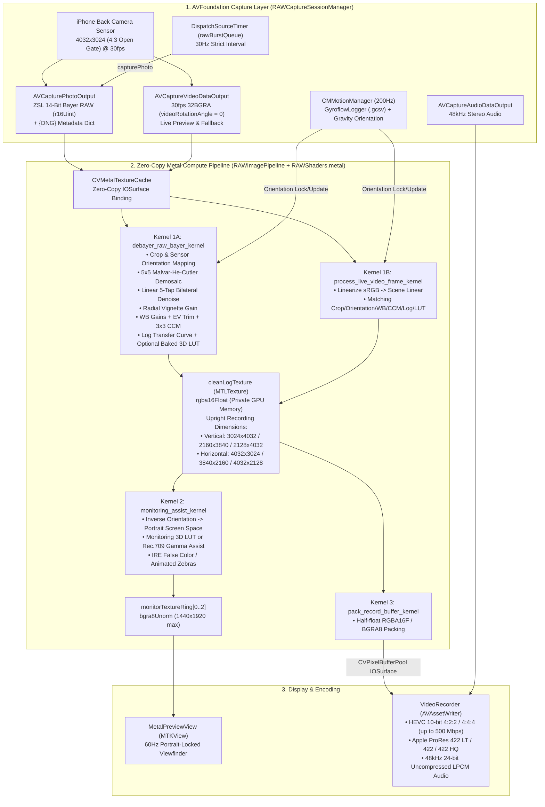

# Log Cam (iOS Open Gate 30fps RAW-to-Log Cinema Camera)

An iOS 17+ cinema camera application modelled after **Log Cam: Open Gate by RAW Cam** (`id6766185881`).

Standard iOS video recording (`AVCaptureMovieFileOutput` / standard `AVCaptureVideoDataOutput`) routes sensor data through Apple's video ISP pipeline, which enforces 16:9 sensor cropping, temporal noise reduction (TNR), edge sharpening, and Smart HDR local tone mapping. **Log Cam** bypasses the video ISP by driving `AVCapturePhotoOutput` in Zero-Shutter-Lag (ZSL) mode up to **30 times per second** to capture uncompressed **14-bit Bayer RAW** sensor buffers (`4032×3024` Open Gate 4:3) and developing them in real time on the GPU via custom Metal compute shaders into 10-bit Log HEVC or Apple ProRes video.

---

## 1. Repository Structure

```text
LogCam/
├── App/
│   ├── LogCamApp.swift                 # SwiftUI @main entry point
│   └── Info.plist                      # Portrait-locked UI, camera/mic permissions, file sharing enabled
├── Camera/
│   ├── RAWCaptureSessionManager.swift  # AVFoundation session, 30Hz ZSL RAW burst engine, exposure/WB/focus control
│   ├── GyroflowLogger.swift            # 200Hz CoreMotion IMU logger (.gcsv) + gravity-based sensor orientation tracker
│   └── SyntheticRAWGenerator.swift     # 14-bit RGGB Bayer test-pattern generator (Simulator only)
├── Models/
│   └── CameraSettings.swift            # Gate modes, codecs, Log curves, shutter/WB/assist enums, RAWFrameMetadata
├── Pipeline/
│   ├── RAWImagePipeline.swift          # Metal device, CVMetalTextureCache, 3-pass compute dispatch, triple-buffered monitor ring
│   ├── RAWShaders.metal                # Malvar-He-Cutler 5x5 demosaic, 8 Log curves, 3D LUT, Zebras, IRE False Color
│   └── CubeLUTLoader.swift             # .cube 3D LUT parser + procedural built-in LUT generator -> MTLTexture (type3D)
├── Recording/
│   ├── VideoRecorder.swift             # AVAssetWriter 10-bit HEVC (4:2:2/4:4:4) & ProRes 422 recorder + 48kHz 24-bit PCM audio
│   └── AudioMonitor.swift              # Real-time stereo RMS/Peak dBFS audio level meter extractor
└── Views/
    ├── CameraMainView.swift            # Main cinema HUD, telemetry bar, lens switcher, assist toggles, transport bar
    ├── MetalPreviewView.swift          # 60Hz MTKView live viewfinder + 2-axis horizon level, rule-of-thirds grid, IRE legend
    ├── ExposureWBControlsView.swift    # Bottom drawers for Shutter Priority / Manual ISO, Kelvin/Tint WB, Focus, LUTs
    ├── PipelineSettingsSheet.swift     # Full settings sheet (Gate, FPS, Codec, Bitrate, Log Curve, Denoise, Vignette, Gyroflow)
    └── RecordingsBrowserView.swift     # In-app clip browser, AVPlayer preview, ShareSheet export (.mov + .gcsv sidecar)
LogCamTests/
└── LogCamPipelineTests.swift           # Unit tests for LUT parsing, Bayer synthesis, and Metal compute pipeline execution
```

---

## 2. End-to-End Architecture & Dataflow



---

## 3. Core Subsystems in Detail

### 3.1 Dual-Stream Capture & 30fps RAW Burst Engine (`RAWCaptureSessionManager.swift`)
* **Session Configuration (`configureHardwareSession`)**:
  * Uses `captureSession.sessionPreset = .inputPriority` so the active `AVCaptureDevice.Format` is never overridden by preset changes.
  * Attaches `AVCaptureVideoDataOutput` (`kCVPixelFormatType_32BGRA`, `videoRotationAngle = 0`) and `AVCapturePhotoOutput` (`maxPhotoQualityPrioritization = .balanced`, `isZeroShutterLagEnabled = true`, `isAutoDeferredPhotoDeliveryEnabled = false` on iOS 17+).
  * **Why `.balanced` instead of `.speed`?** On iOS 16+, setting `maxPhotoQualityPrioritization = .speed` on `AVCapturePhotoOutput` throws an `NSInvalidArgumentException` when capturing uncompressed 12MP/48MP Bayer RAW photos. `.balanced` with `isZeroShutterLagEnabled = true` reads directly from the ISP ring buffer without shutter lag.
* **Format Selection (`selectBestRAWOpenGateFormat`)**:
  * Filters `device.formats` for 8-bit bi-planar YUV (`420v` / `420f`) formats supporting 30.0 fps with a 4:3 aspect ratio (`width <= 4032`, `height <= 3024`), sorting highest pixel count first and prioritizing formats whose `supportedMaxPhotoDimensions` includes `4032×3024`.
  * Probes candidate formats to select one where `!photoOutput.availableRawPhotoPixelFormatTypes.isEmpty`.
* **30Hz Burst Loop & In-Flight Backpressure (`startRAWBurstTimer` / `fireSingleZeroShutterLagRAWPhoto`)**:
  * When recording starts on hardware (and `activeRawPixelFormat != 0`), a `DispatchSourceTimer` on `rawBurstQueue` triggers `photoOutput.capturePhoto(with: settings, delegate: proxy)` at the selected frame rate (`24`, `25`, or `30` Hz).
  * `inFlightRAWPhotoCount` is guarded by `inFlightLock` (`maxInFlightRAWPhotos = 4`) so that if the ISP or GPU momentarily falls behind, capture requests are dropped cleanly rather than exhausting IOSurface memory.
  * While RAW burst frames are actively arriving (`CACurrentMediaTime() - lastRAWPhotoFrameTime < 0.35`), `captureOutput(_:didOutput:from:)` on `videoDataOutput` yields so only the 14-bit Bayer RAW path drives the preview and `VideoRecorder`. When not recording (or on lenses/devices that do not expose Bayer RAW), `videoDataOutput` drives the preview and recording seamlessly.

### 3.2 Zero-Copy Metal Compute Pipeline (`RAWImagePipeline.swift` & `RAWShaders.metal`)
All image processing runs on a single `MTLCommandBuffer` per frame with three compute kernels:

1. **Pass 1A — 14-Bit Bayer RAW Development (`debayer_raw_bayer_kernel`)**:
   * **Input**: `CVPixelBuffer` (`kCVPixelFormatType_14Bayer_RGGB` / `BGGR` / `GRBG` / `GBRG`) bound zero-copy via `CVMetalTextureCacheCreateTextureFromImage` as `.r16Uint`.
   * **Black/White Level Normalization (`sampleNormalizedCFA`)**: Subtracts per-quadrant `BlackLevel` (`SIMD4<Float>`) and normalizes by `WhiteLevel - BlackLevel` from the photo's `{DNG}` metadata dictionary.
   * **Malvar-He-Cutler 5×5 Demosaicing (`demosaicMalvarHeCutler`)**: Implements the Malvar, He, and Cutler (2004) gradient-corrected bilinear interpolation filter using integer weights (`/ 8.0f`) over a 5×5 neighborhood to reconstruct full-resolution linear RGB without the zippering artifacts of simple bilinear demosaicing.
   * **Spatial Bilateral Denoise**: Optional 5-tap edge-preserving filter in linear scene-referred space (`sigmaRange = 0.04 + 0.08 * denoiseStrength`).
   * **Radial Vignette Compensation**: Polynomial gain `1.0 + strength * (0.42 * r^2 + 0.18 * r^4)` computed in true sensor coordinates `(sx, sy)`.
   * **White Balance, Exposure & Color Matrix**: Multiplies by `wbGains` (either `{DNG}` `AsShotNeutral` or manual Kelvin/Tint converted via Planckian locus approximation in `kelvinAndTintToGains`), applies `exp2(baselineExposureEV + exposureTrimEV)`, and multiplies by the 3×3 Color Correction Matrix (`colorMatrixRow0..2`).
   * **Log Transfer Function (`applyLogCurve`)**: Encodes scene-linear RGB into one of 8 transfer curves:
     * **Apple Log** (piecewise linear/logarithmic per Apple Log Profile White Paper)
     * **ARRI LogC3** (EI 800 specification)
     * **ARRI LogC4** (ALEXA 35 specification)
     * **Sony S-Log3**
     * **RED Log3G10**
     * **Canon Log 3**
     * **Blackmagic Design Film Gen 5**
     * **Rec.709** (ITU-R BT.709 OETF)
   * **Optional Baked-In 3D LUT (`sample3DLUT`)**: Hardware trilinear sampling on a `texture3d<float>` (`rgba16Float`) loaded from `.cube` files or procedurally generated built-in LUTs.
   * **Output**: Writes into `cleanLogTexture` (`.rgba16Float`, `.private` storage mode).

2. **Pass 1B — Live Video Preview Development (`process_live_video_frame_kernel`)**:
   * Used during standby preview (to save battery/thermals before recording) or as a fallback when RAW photo capture is unavailable.
   * Linearizes the camera buffer (`pow(srgb, 2.2) * 0.45`), applies the identical sensor crop, orientation mapping, vignette, WB trim, 3×3 color matrix, Log curve, and optional baked 3D LUT into `cleanLogTexture`.

3. **Pass 2 — Monitoring Assists (`monitoring_assist_kernel`)**:
   * Reads `cleanLogTexture` (`rgba16Float`) and writes into the next texture in the 3-buffer `monitorTextureRing` (`bgra8Unorm`, max `1440×1920`).
   * Applies monitoring-only 3D LUT or Rec.709 viewing gamma assist (when not already baked into the recording).
   * Applies **IRE False Color** (`falseColorMap`, mapping IRE luminance zones to purple/blue/cyan/green/pink/yellow/red) or **Animated Zebra Stripes** (`zebraThreshold`).

4. **Pass 3 — Recording Buffer Packing (`pack_record_buffer_kernel`)**:
   * When `destinationRecordPixelBuffer` is provided by `VideoRecorder.dequeueRecordPixelBuffer()`, binds the `AVAssetWriterInputPixelBufferAdaptor`'s `CVPixelBuffer` (`kCVPixelFormatType_64RGBAHalf`) via `CVMetalTextureCache` and copies `cleanLogTexture` into it on the GPU.

### 3.3 Sensor vs. Screen Orientation Mathematics
A classic failure mode in iOS camera apps is fighting `UIWindow` auto-rotation against `AVCaptureConnection` rotation. Log Cam solves this cleanly:
* **UI Window is Locked to Portrait**: `Info.plist` restricts `UISupportedInterfaceOrientations` to `UIInterfaceOrientationPortrait`. The SwiftUI chrome and `MTKView` (`MetalPreviewView`) never resize or spin when the phone rotates.
* **Gravity-Driven Orientation Tracking (`GyroflowLogger.swift`)**:
  * CoreMotion's 200Hz `deviceMotion` stream inspects `motion.gravity.x` and `motion.gravity.y` with hysteresis (`0.65` vs `0.45`) to classify physical sensor orientation into `SensorCaptureOrientation`:
    * `0` = `.landscapeLeft` (horizontal, Dynamic Island on left)
    * `1` = `.landscapeRight` (horizontal, Dynamic Island on right)
    * `2` = `.portrait` (vertical, upright)
    * `3` = `.portraitUpsideDown` (vertical, inverted)
  * Because this uses the accelerometer gravity vector directly, it works even when the user has iOS **Portrait Orientation Lock** enabled in Control Center.
* **Coordinate Mapping in `RAWShaders.metal`**:
  * Both `photoOutput` and `videoDataOutput` (`videoRotationAngle = 0`) deliver buffers in native sensor coordinates (`rawW = 4032, rawH = 3024`).
  * `CaptureGateMode.dimensions(for: orientation)` sets `cleanLogTexture` and `VideoRecorder` dimensions to vertical (`3024×4032`, `2160×3840`, `2128×4032`) when `orientation.isPortrait` is true, and horizontal (`4032×3024`, `3840×2160`, `4032×2128`) when horizontal.
  * In Pass 1 (`debayer_raw_bayer_kernel` / `process_live_video_frame_kernel`), output pixel UV `normUV` in `cleanLogTexture` maps to sensor crop UV `cropUV` via `orientation = (u.rotate180 >> 1) & 3`:
    * `0` (`landscapeLeft`): `(normUV.x, normUV.y)`
    * `1` (`landscapeRight`): `(1 - normUV.x, 1 - normUV.y)`
    * `2` (`portrait`): `(normUV.y, 1 - normUV.x)`
    * `3` (`portraitUpsideDown`): `(1 - normUV.y, normUV.x)`
  * In Pass 2 (`monitoring_assist_kernel`), the Portrait-locked screen UV `mUV` applies the exact inverse transform to sample `cleanLogTexture`, so the composition `Sensor -> cleanLogTexture -> monitorTexture` is always `(mUV.y, 1 - mUV.x)`. Thus the live image on the physical screen stays 100% locked to the real world while `cleanLogTexture` (and the recorded `.mov`) is always upright in its native vertical or horizontal canvas.

### 3.4 10-Bit Video Encoding & Gyroflow Sidecar (`VideoRecorder.swift` & `GyroflowLogger.swift`)
* **Codecs**:
  * **HEVC 10-Bit 4:2:2** (`kCMVideoCodecType_HEVC`, `VTCompressionPropertyKey_ProfileLevel = "HEVC_Main42210_AutoLevel"`)
  * **HEVC 10-Bit 4:4:4** (`kCMVideoCodecType_HEVC`, `VTCompressionPropertyKey_ProfileLevel = "HEVC_Main44410_AutoLevel"`, fallback to `kVTProfileLevel_HEVC_Main10_AutoLevel` if rejected by hardware)
  * **Apple ProRes 422 LT / 422 / 422 HQ** (`apcs` / `apcn` / `apch`, fallback to HEVC 10-Bit on devices that do not support hardware ProRes encoding)
* **Color Tagging**: Embeds `AVVideoColorPropertiesKey` (`WideGamut` / `ITU_R_709_2` / `ITU_R_2020`) and QuickTime metadata (`com.apple.proapps.customlut`, `com.apple.quicktime.camera.lens_model`) so NLEs (DaVinci Resolve, Final Cut Pro, Premiere) identify the clip's gamut and Log profile.
* **Gyroflow `.gcsv` Sidecar**: Records 200Hz 3-axis gyroscope (`rad/s`) and accelerometer (`m/s²`) samples in `GyroflowLogger.swift` using the `GYROFLOW IMU LOG` v1.3 specification (`tscale,0.001000`, `gscale,1.000000`, `ascale,1.000000`, `orientation,YxZ`) alongside every `.mov` clip.

---

## 4. Areas for Code Review & Critique (Notes for ChatGPT)

When reviewing or critiquing this codebase, the following architectural trade-offs and implementation details are particularly worth scrutinizing:

1. **Synchronous GPU Wait in `RAWImagePipeline.swift` (`commandBuffer.waitUntilCompleted()`)**:
   * Both `processRAWBayerFrame` and `processLiveVideoPreviewFrame` currently call `commandBuffer.waitUntilCompleted()` on the capture callback queue (`rawBurstQueue` / `videoSampleQueue`) before returning the `MTLTexture` and appending `destBuffer` to `VideoRecorder`.
   * *Critique question*: While this keeps the frame lifecycle simple and hits 30fps at `4032×3024` on modern A17 Pro / A18 Pro GPUs, would pipelining with `commandBuffer.addCompletedHandler` and a semaphore (3 frames in flight) reduce CPU-GPU bubble latency and improve frame-pacing jitter?

2. **5×5 Demosaic Redundancy During Spatial Bilateral Denoising (`RAWShaders.metal`)**:
   * In `debayer_raw_bayer_kernel`, when `denoiseStrength > 0.01`, the kernel calls `demosaicMalvarHeCutler` 5 times per output pixel (center `(sx, sy)` plus 4 neighbors at `(sx ± 2, sy ± 2)`).
   * *Critique question*: Splitting demosaicing into its own intermediate `rgba16Float` texture pass (or caching demosaiced pixels in `threadgroup half3` memory) would reduce CFA texture reads by 5× when noise reduction is enabled.

3. **DNG Color Matrix & Camera-to-Working-Gamut Math (`RAWCaptureSessionManager.swift` & `RAWShaders.metal`)**:
   * `extractDNGMetadata` currently reads `ColorMatrix2` from the `{DNG}` dictionary and normalizes each row to sum to `1.0`, applying it directly to white-balanced camera RGB before the Log OETF.
   * *Critique question*: In the full DNG specification, `ColorMatrix2` maps XYZ (D65) to camera native space (`XYZ_to_Camera`), not `Camera_to_WorkingGamut`. A strict ACES / cinema color pipeline should invert the interpolated `ColorMatrix1`/`ColorMatrix2` (or use `ForwardMatrix1`/`ForwardMatrix2` with Bradford chromatic adaptation) and multiply by the `XYZ_to_AWG3` / `XYZ_to_AWG4` / `XYZ_to_Rec2020` / `XYZ_to_SGamut3Cine` matrix matching the selected Log curve's color primaries.

4. **Live Video Preview Linearization Approximation (`process_live_video_frame_kernel`)**:
   * During standby preview (before pressing Record), `process_live_video_frame_kernel` approximates inverse tone-mapping of the ISP's 8-bit `32BGRA` buffer using `pow(srgb, 2.2) * 0.45` and divides `wbGains` by a fixed reference `float3(2.05, 1.0, 1.65)` before applying the Log curve.
   * *Critique question*: When transitioning from standby preview (`videoDataOutput`) to recording (`photoOutput` 14-bit Bayer RAW), there can be a visible exposure/color shift because `videoDataOutput` already has Apple ISP auto-white-balance and tone mapping baked in, whereas `photoOutput` is true linear sensor data. How can standby preview better match the true Bayer RAW rendering (e.g., running a low-rate 5–10Hz ZSL RAW burst in standby or calibrating the preview LUT against the most recent RAW frame)?

5. **`AVAssetWriter` Pixel Buffer Format (`kCVPixelFormatType_64RGBAHalf`)**:
   * `VideoRecorder.swift` configures `AVAssetWriterInputPixelBufferAdaptor` with `kCVPixelFormatType_64RGBAHalf` (`rgba16Float` — 64 bits/pixel) and relies on VideoToolbox's hardware encoder to convert to 10-bit 4:2:2 / 4:4:4 YCbCr.
   * *Critique question*: Would writing directly into `kCVPixelFormatType_420YpCbCr10BiPlanarVideoRange` (`x420`) or `kCVPixelFormatType_422YpCbCr10BiPlanarVideoRange` (`x422`) via a custom RGB-to-YCbCr Metal compute kernel cut memory bandwidth to VideoToolbox in half during `4032×3024` 30fps recording?

6. **Shutter-Priority Auto-ISO Control Loop (`stepShutterPriorityAutoISO`)**:
   * In Shutter-Priority mode, `stepShutterPriorityAutoISO` reads `device.exposureTargetOffset` on every video frame and dispatches `device.setExposureModeCustom(duration:iso:)` to `sessionQueue` whenever `abs(offset) > 0.15`.
   * *Critique question*: Because `setExposureModeCustom` is asynchronous and takes 2–3 frames to settle sensor gain, calling it on every frame without a cooldown or PID/completion-handler gate can cause ISO oscillation or lock contention with `photoOutput`.

---

## 5. Building & Packaging

### Build for iOS Simulator (with Unit Tests)
```bash
xcodebuild -project LogCam.xcodeproj \
  -scheme LogCam \
  -destination 'platform=iOS Simulator,name=iPhone 17 Pro' \
  test
```

### Build Unsigned `.ipa` for Physical Device Sideloading
```bash
xcodebuild -project LogCam.xcodeproj \
  -scheme LogCam \
  -configuration Release \
  -sdk iphoneos \
  -derivedDataPath build/DerivedDataDevice \
  CODE_SIGN_IDENTITY="" CODE_SIGNING_REQUIRED=NO CODE_SIGNING_ALLOWED=NO \
  build

rm -rf build/Payload LogCam.ipa
mkdir -p build/Payload
cp -R build/DerivedDataDevice/Build/Products/Release-iphoneos/LogCam.app build/Payload/LogCam.app
codesign --force --sign - --timestamp=none build/Payload/LogCam.app
ditto -c -k --sequesterRsrc --keepParent build/Payload LogCam.ipa
```
